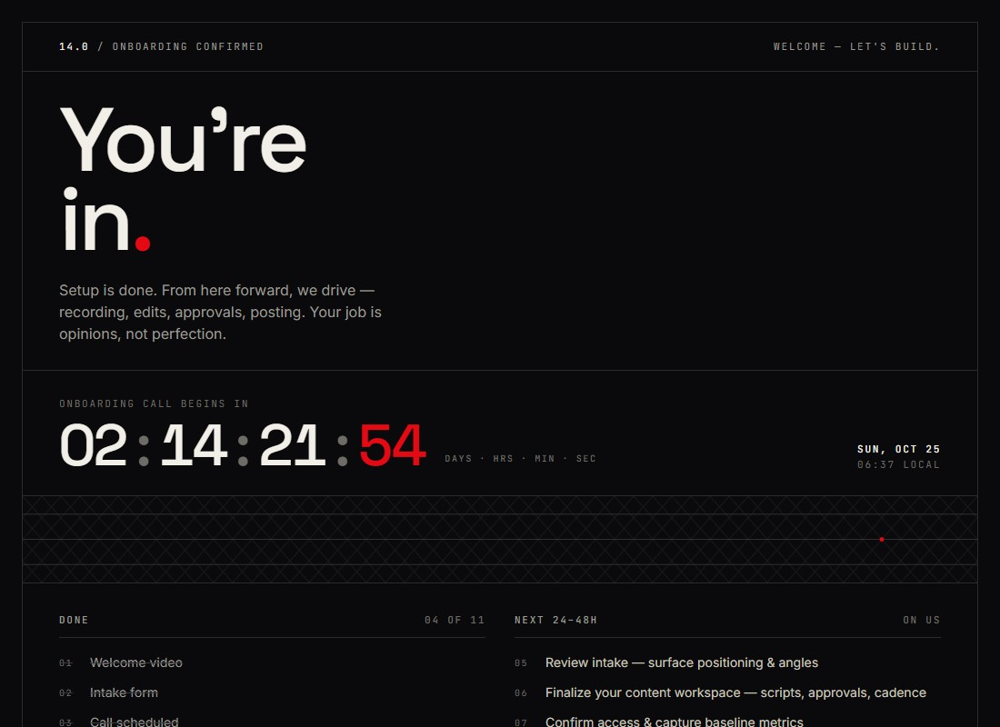
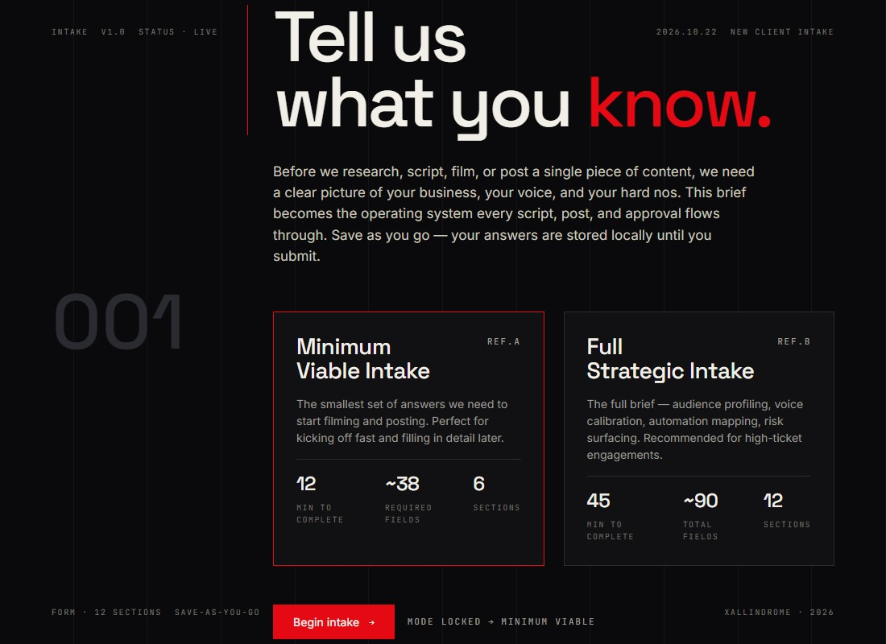

# xallindrome-widgets

**Embeddable lead-gen and onboarding widgets for small-business sites: a 60-second "leak score" quiz, a long-form intake form, and a post-booking countdown, plus a tiny script loader.** Plain script tags, no framework needed on the host page, and no backend baked in.

| Quiz (Delphi) | Countdown (Kairos) | Intake form (Plato) |
|---|---|---|
|  |  |  |

<sub>Screenshots are of the dev servers from this repo (`npm run dev:quiz` etc.).</sub>

## Quickstart

You need [Node.js](https://nodejs.org) 20 or newer.

```bash
git clone https://github.com/xallindrome-labs/xallindrome-widgets.git
cd xallindrome-widgets
npm install
npm run dev:quiz
```

Open the URL Vite prints. Try the other two with `npm run dev:intake` and `npm run dev:countdown`.

Build everything and run the checks:

```bash
npm run verify     # typecheck + tests + build
```

## What's in here

| Path | What it is |
|---|---|
| `apps/delphi-quiz-widget` | **Delphi.** Tap-only lead-gen quiz that ends in a Leak Score, an archetype and an optional inline calendar embed. |
| `apps/plato-intake-form` | **Plato.** Long-form, save-as-you-go intake with two depth modes, 12 sections and a review screen. Optional Cloudflare Turnstile. [Details](docs/widgets/plato-intake.md) |
| `apps/kairos-onboarding-countdown` | **Kairos.** Live countdown to a booked call, personalised from the browser or a URL. [Details](docs/widgets/kairos-countdown.md) |
| `apps/public-widget-platform` | A 1 kB loader SDK: `XallindromeWidgets.mount(target, { scriptUrl, globalName, props })`. |
| `libs/public-widget-catalog` | One JSON file describing every widget (ids, global names, artifact names, embed query params). The release tooling reads it. |
| `libs/pricing-domain` | Dependency-free pricing model (base package + per-unit overage + add-ons) with tests. Example numbers only. |
| `tools/widgets` | Release helpers that turn a build into versioned, CDN-ready files and hosted embed pages. |

## Use a widget on your site

Build, prepare the release files, and put them on any static host:

```bash
npm run build
npm run release:prepare -w delphi-quiz-widget -- 1.0.0 https://widgets.your-domain.com
```

That writes `apps/delphi-quiz-widget/dist/release/widgets/delphi-quiz/{v1.0.0,latest}/widget.iife.js` (plus an ES module and a hosted embed page). Upload the `release/` folder, then:

```html
<div data-delphi-quiz-widget data-api-base-url="https://api.your-domain.com"></div>
<script src="https://widgets.your-domain.com/widgets/delphi-quiz/latest/widget.iife.js"></script>
```

or mount it from code with the loader SDK (see [its README](apps/public-widget-platform/README.md)).

## Bring your own backend

The widgets are front-end only. Where a widget can talk to a server, it does so through one prop, `apiBaseUrl`, and a small documented contract (for example `POST {apiBaseUrl}/public/automation/quiz` for the quiz and `POST {apiBaseUrl}/public/intake` for the intake form). Leave it unset and each widget still works, keeping answers in the browser. No hosts, keys or account IDs are built in; the `example.com` URLs in the docs are placeholders.

## Issues and contributing

Bug reports and ideas are welcome on the [issue tracker](https://github.com/xallindrome-labs/xallindrome-widgets/issues). Pull requests are welcome too, but reviewed slowly; see [CONTRIBUTING.md](CONTRIBUTING.md). Please report security problems privately, as described in [SECURITY.md](SECURITY.md). Third-party licenses are listed in [ATTRIBUTION.md](ATTRIBUTION.md).

## License

[MIT](LICENSE)

---

**Built by [Xallindrome](https://xallindrome.co)**: we build automation and AI workflows for small businesses. If you'd like something like this for your business, [book a diagnostic](https://xallindrome.co).
